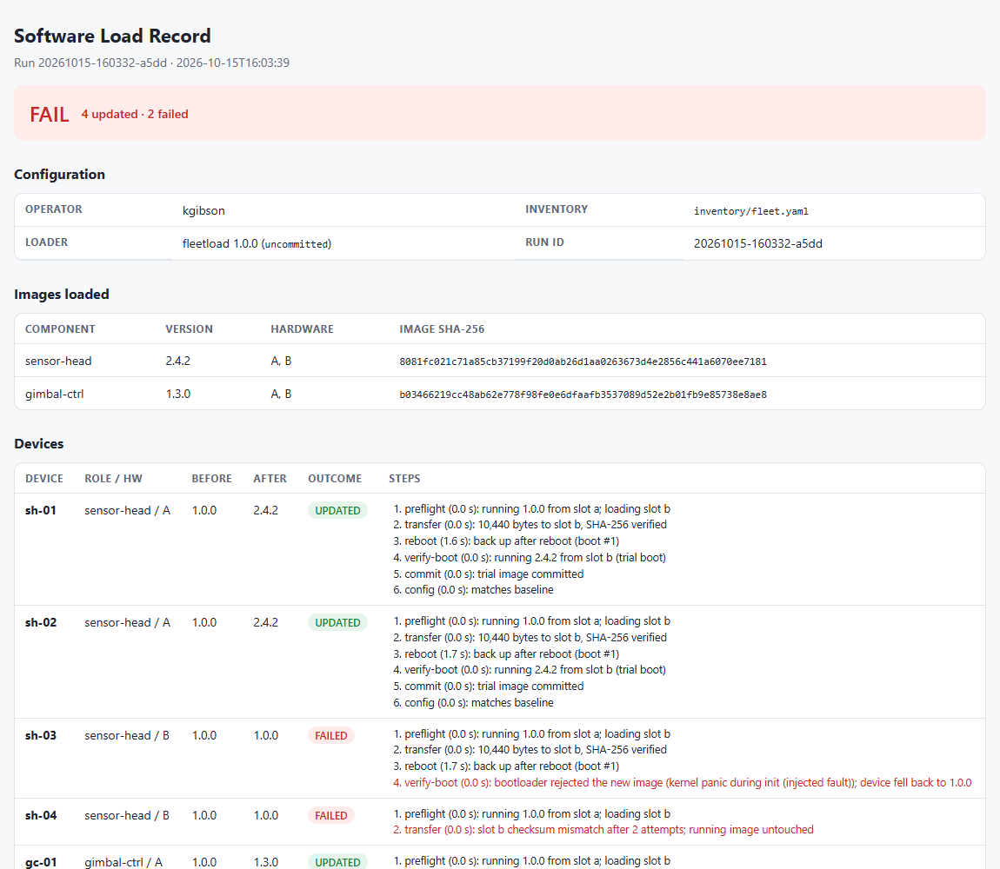
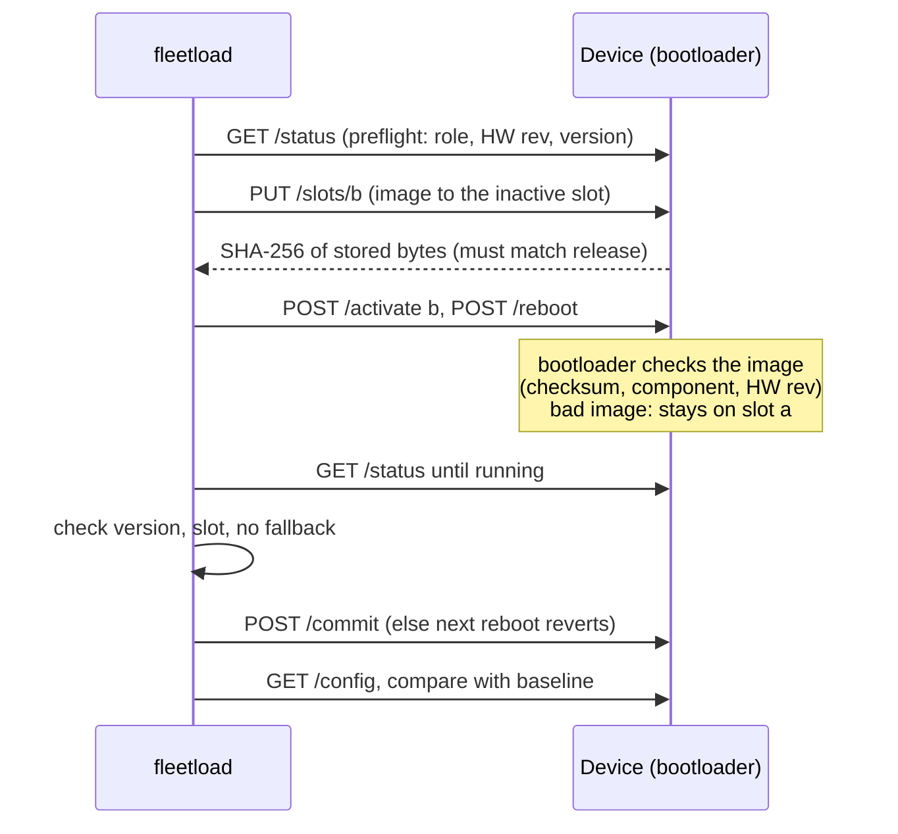

# fleet-software-loader

[](https://github.com/KyleEGibson/fleet-software-loader/actions/workflows/ci.yml)


`fleetload` pushes versioned firmware to a group of embedded devices, checks each step, and writes a load record you could hand to V&V.

The "devices" are Docker containers running a small fake target with A/B firmware slots and a bootloader, the same update scheme a lot of embedded products use. The loader never overwrites the image that's running. It:
- checks the SHA-256 at three different points
- boots new images on trial, so a load that dies halfway reverts on the next reboot
- does a canary device first and stops the rollout if something fails
- compares each device's config against a baseline kept in the repo



## How a load works

Canary devices go first, one at a time, then the rest in parallel batches. If failures go over `--max-failures` the rollout stops, and the devices it didn't get to show up as NOT ATTEMPTED.

## What it covers
| Test/integration task | Where |
|---|---|
| Loading software onto multiple units for V&V | `fleetload deploy`, `src/fleetload/deploy.py` |
| Setting up systems under test | `docker-compose.yml` (6 devices, 2 roles, 2 HW revs), inventory |
| Configuration management | `baselines/`, `config audit/apply`, reproducible builds, release manifest |
| Troubleshooting | per-step results, JSON-lines audit log, fault injection (`docker-compose.faults.yml`) |
| Documentation | load record (HTML/Markdown), [`docs/image_format.md`](docs/image_format.md) |
| Test automation | 42 pytest tests: in-process devices, CLI end to end, and the container fleet in CI |

## Running it
```bash
python -m venv .venv && .venv\Scripts\activate          # source .venv/bin/activate on Linux/macOS
pip install -e ".[dev]"
docker compose up -d --build --wait                       # 6 devices on 127.0.0.1:9001-9006

fleetload build firmware/sensor-head                      # writes to releases/ + manifest.json
fleetload build firmware/gimbal-ctrl
fleetload status
fleetload deploy sensor-head:2.4.2 gimbal-ctrl:1.3.0 --canary 1 --batch 2
fleetload rollback sh-03
fleetload config audit
fleetload config apply gc-02 --dry-run
```
With faults turned on:
```bash
docker compose down
docker compose -f docker-compose.yml -f docker-compose.faults.yml up -d --wait
fleetload deploy sensor-head:2.4.2 gimbal-ctrl:1.3.0     # stops at sh-03 (boot fails)
```

| Fault | What happens |
|---|---|
| `CORRUPT_WRITE` (bad flash write) | checksum mismatch after the write, one retry, then FAILED at transfer. The device is never rebooted. |
| `BOOT_FAIL` (image won't start) | bootloader stays on the old slot, FAILED at verify-boot. Old software keeps running. |
| `CONFIG_DRIFT` | load works, drift is listed per key |
| `SLOW` (no response) | timeout, FAILED at preflight |
| image doesn't support the HW rev | INCOMPATIBLE, nothing written |

## Tests
```bash
pytest -m "not docker"     # 41 tests, ~30 s, no Docker needed
pytest -m docker           # starts the fault fleet, runs two rollouts, tears it down
```
I mutation-tested two of the safety checks by hand. Turning off the transfer checksum compare made a test fail. Turning off the bootloader-fallback check also failed a test, but through the later version check, so that case is caught twice.

## Layout
```
device/agent.py            fake device: A/B slots, bootloader, config, faults (stdlib only)
device/Dockerfile          python:3.12-alpine, non-root
src/fleetload/image.py     image format, builds, release manifest
src/fleetload/deploy.py    per-device steps, rollout, rollback
src/fleetload/client.py    device HTTP client
src/fleetload/inventory.py inventory, baselines, config drift
src/fleetload/report.py    load record (HTML + Markdown)
firmware/                  component sources
baselines/                 config baseline per role
docs/image_format.md       image format + device API spec
```
